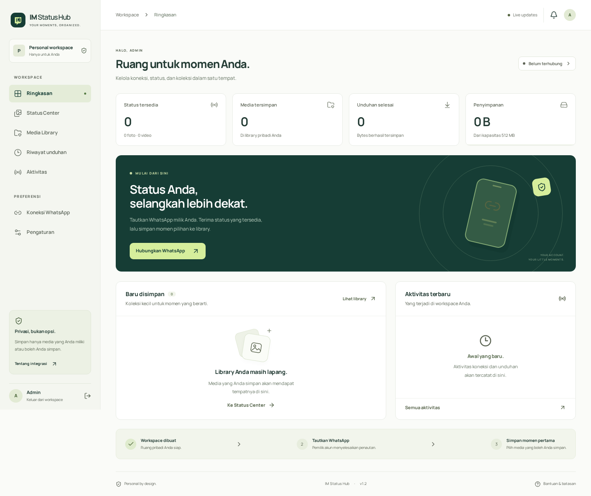

# IM Status Hub — v2.0.0 SQLite Local

**Momen singkat. Tersimpan rapi.** Workspace pribadi untuk menerima Status WhatsApp yang tersedia, menyimpan foto/video dengan izin, dan mengelola library persisten.

## Lebih sederhana

**Satu service web + worker, satu password admin, tanpa PostgreSQL atau connection string.** Database adalah file SQLite di server; bukan database browser/HP. Di Railway pasang satu volume `/data`, isi ADMIN_PASSWORD, gunakan domain publik, lalu deploy.

➡ **[START-HERE.md](START-HERE.md)** — panduan singkat yang sebaiknya dibaca dulu.

> Integrasi memakai **Baileys 7.0.0-rc14**, library tidak resmi WhatsApp/Meta, release candidate, MIT. Tidak bisa mengambil semua Status, melewati privasi, atau menjamin bebas ban. Gunakan hanya akun sendiri/berizin. Pemilik menyelesaikan penautan sendiri.



## Fitur

- Login admin satu password, tanpa email/signup/undangan/default password; bootstrap admin atomik dan rotasi session saat password berubah.
- Landing, dashboard, QR/kode penautan, Status Center, Media Library, riwayat, aktivitas, preferensi; responsive mobile/desktop, font lokal dan ikon Lucide.
- SQLite/Prisma: metadata, login, credentials terenkripsi, antrean, aktivitas dan preferensi. WAL + single-writer transactions; tidak membutuhkan server DB eksternal.
- Satu supervisor menjalankan **dua proses internal**: Next.js dan worker Node long-lived. Worker file server hanya bind loopback; browser memakai API web yang terautentikasi.
- Kunci AES-256-GCM dibuat sekali ke file privat pada volume; tidak memakai auth multi-file plaintext Baileys. QR/code bukan tanda Connected; hanya event provider-open yang mengubah status.
- Cookie HttpOnly/Secure/SameSite, exact-origin + CSRF, per-resource ownership, validasi, atomic rate limits, SSRF/DNS/path/MIME protections, no-store media dan SSE owner-scoped.
- Job unduhan durable, timeout/retry/dedupe, original bytes, thumbnail, preview video dan HTTP Range; search/filter/pagination, grid/list, delete confirmation, retention.
- Maksimal **64 MiB/file**, **512 MiB/admin**, retensi 1–90 hari (default 7). Preview penuh menyimpan file ke library setelah konfirmasi pengguna.

## Jalankan lokal

Linux dengan **Node 22**, npm, `flock` (util-linux), FFmpeg/ffprobe. Untuk Windows/macOS gunakan Docker Linux, bukan menjalankan script flock secara native.

```bash
npm ci
npm run setup
npm run db:generate
npm run build
npm start
```

`setup` membuat `.env` berisi ADMIN_PASSWORD acak dan tidak mencetaknya. Baca nilainya secara privat atau ganti dengan password kuat sendiri. Script tidak menimpa `.env` lama. Buka `http://localhost:3000` dan login. **Tidak ada perintah migrasi manual, service database atau terminal worker kedua.**

Mode development: `npm run dev` (migrasi dan worker juga dijalankan otomatis). Data lokal berada di `runtime/data`; jangan hapus folder ini bila ingin mempertahankan data.

### Docker Compose lokal

```bash
npm run setup
# Atau buat .env sendiri berisi ADMIN_PASSWORD yang kuat.
docker compose up --build
```

Satu container + satu named volume. Compose memakai HTTP localhost dan COOKIE_SECURE=false hanya untuk lokal. Dockerfile produksi menggunakan Node 22, FFmpeg, util-linux, gosu, dan proses non-root. Konfigurasi Docker/Compose disediakan tetapi belum dijalankan pada Docker daemon dalam pengujian ini.

## Railway

Ikuti [START-HERE](START-HERE.md) atau [DEPLOYMENT](docs/DEPLOYMENT.md). Volume wajib mount `/data` pada **service aplikasi yang sama**, bukan service worker lama. Database/media/key disimpan di subfolder `/data/im-status-local` agar tidak menyentuh folder media worker v1.

Origin dibentuk dari environment tepercaya RAILWAY_PUBLIC_DOMAIN, bukan header request. Custom domain dapat ditambahkan melalui APP_ORIGIN. Koneksi database PostgreSQL lama diabaikan oleh entrypoint v2. Jangan mengubah DATABASE_URL menjadi `localhost`: v2 menentukannya sendiri sebagai URL file.

**Satu replica, tanpa serverless/sleep, tanpa horizontal scaling.** SQLite cocok untuk workspace pribadi; bukan pengganti database multi-node. Penguncian instance memerlukan filesystem lokal POSIX; network share/NFS tidak didukung.

## Data versi lama

Ini rilis major dengan database baru. **Tidak ada impor otomatis PostgreSQL → SQLite.** Login/data lama tidak otomatis tampil; source dan database/volume v1 tidak dihapus oleh paket ini. Backup sebelum mengganti deployment. Hentikan worker v1 dan, bila perlu, cabut perangkat tertaut lama dari WhatsApp sebelum menautkan akun sendiri di workspace baru.

Jangan mencampur migrasi v1 dengan folder `prisma/` v2. Jangan memindahkan file PostgreSQL mentah menjadi file SQLite.

## Menghubungkan WhatsApp

1. Login → Koneksi WhatsApp; pastikan worker dan storage siap.
2. Pilih QR atau kode penautan (nomor internasional berupa angka), baca risiko dan centang kepemilikan/izin.
3. Pemilik membuka WhatsApp → Perangkat tertaut → Tautkan perangkat. Selesaikan QR/kode sendiri; jangan mengirim OTP/QR/code ke operator.
4. Tunggu status Terhubung dari backend. Menampilkan QR/code saja belum berarti terhubung.
5. Status baru hanya muncul bila benar-benar tersedia/dikirim ke sesi ini; refresh membaca database, bukan mengambil seluruh Status teman.

## Pengujian

```bash
npx playwright install --with-deps chromium
npm run verify
```

Tidak memerlukan PostgreSQL. Verifier membuat file SQLite disposable khusus di `runtime/verification_test.sqlite`, menjalankan unit/integration/startup/browser tests, build, lint, typecheck dan npm audit. Port 3300, 3301, 3210, 3212 dan 3213 harus bebas. Data pada file test tersebut dihapus oleh suite; jangan gunakan file itu untuk produksi.

Lihat [TESTING](docs/TESTING.md), [SECURITY](docs/SECURITY.md), [ARCHITECTURE](docs/ARCHITECTURE.md), [API](docs/API.md), [PROVIDER](docs/PROVIDER.md), [TROUBLESHOOTING](docs/TROUBLESHOOTING.md), dan [ACCEPTANCE](docs/ACCEPTANCE.md).

## Batas klaim

Tidak ada API resmi all-friends Status, bypass privasi, backfill seluruh riwayat, status sekali lihat, download URL bebas, atau jaminan tidak diblokir. Live pairing/Status/CDN/reconnect/remote logout WhatsApp belum diuji dengan akun nyata. Restart file/session lokal diuji, bukan bukti live reconnect atau persistence volume Railway. Tidak ada push repo atau deployment eksternal dari paket ini.

Lisensi proyek MIT; lisensi dependency/font/tool sistem tetap berlaku. [THIRD_PARTY](docs/THIRD_PARTY.md).
